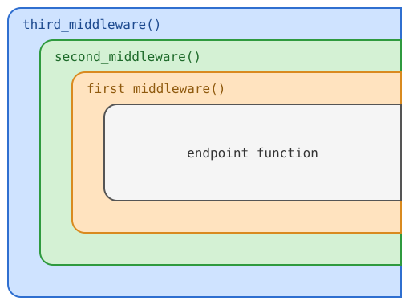

# 1. Middleware

Se for deg at du vil legge på følgende header til alle svarene som APIet ditt sender:

```
Access-Control-Allow-Origin: *
```

(Dette kalles CORS, og du kan lese mer om det her: https://developer.mozilla.org/en-US/docs/Web/HTTP/Guides/CORS.)

Du kunne gjort dette ved å endre alle funksjonene i APIet til å ta inn `Response`-objektet,
og sette headeren manuelt:

```python
@app.get("/some-path")
async def some_operation(response: Response)
    response.headers["Access-Control-Allow-Origin"] = "*"

    # ...resten av funksjonen
```

Dette blir mye duplisert kode. Heldigvis finnes det en enklere måte: Middlewares!
Middlewares er funksjoner som pakker inn endepunktene dine, og kjører både før og etter
selve endepunkts­funksjonen. Disse modifiserer **alle** endepunkter i APIet.

{ align=right width=50% }

Når du legger til en ny middleware havner den "utenfor" alle de eksisterende. Det vil si at den
siste middlewaren du legger til kjører helt først og helt sist.

<div style="clear: both"></div>

## Hvordan skriver man en middleware?

```python
from fastapi import FastAPI, Request, Response
from typing import Awaitable, Callable

app = FastAPI()

@app.middleware("http")
async def my_middleware(request: Request, call_next: Callable[[Request], Awaitable[Response]]): 

    # ...Kode som skjer *før* endepunktsfunksjonen...

    response = await call_next(request)

    # ...Kode som skjer *etter* endepunktsfunksjonen

    return response
```

Hvorfor dette `call_next`-parametret, og hva er den typesignaturen?

Middleware-funksjonen skal ikke trenge å tenke på hvor den befinner seg i middleware-stacken. Alt den bryr
seg om er hva som skjer før og etter neste lag innover. `call_next` er da en funksjon som sender kontrollen
videre innover i stacken. Typesignaturen kan leses som "async-funksjon som tar ett argument av type `Request`
og returnerer en `Response`".

## `request.state`
Som beskrevet over, er middlewares usynlige for hverandre, og for endepunktsfunksjonene. Men hva om du
trenger å la dem snakke sammen? Det finnes en måte å smugle data innover i stacken, ved å bruke `state`-feltet
på request-objektet. `state` er en dict som i utgangspunktet er tom, og hvor du kan lagre hva som helst. Typisk
vil dette være berikende kontekst om forespørselen, for eksempel en autogenerert ID som kan brukes for logging
og tracing.

Dette er kraftig og nyttig, og også lett å misbruke. Prøv å holde deg til "rene" middlewares så godt det lar
seg gjøre.

## Oppgaver

1. Legg til CORS-støtte i APIet ditt.
2. Logg alle kallene som treffer APIet. (FastAPI gjør dette allerede, men det er nyttig å lære seg hva slags felter som finnes i Request-objektet.)
3. Samle metrikker per endepunkt, om antall kall og total/gjennomsnittlig prosesseringstid. Server dette på et eget endepunkt. (Prometheus-format hvis du vil være fancy.)
